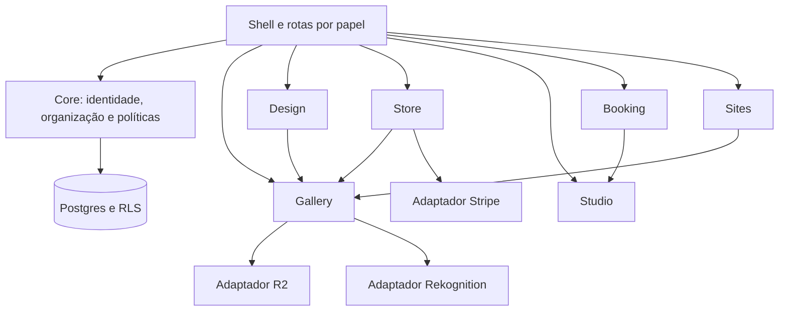

# Arquitetura alvo — monólito modular incremental

Status: direção ADR-001/002 aprovada em 15/11/2026. Contratos e plano de execução sujeitos à revisão técnica; nenhuma pasta funcional ou tabela criada.

## Topologia

Uma aplicação Next.js, um fluxo de identidade Supabase, um Postgres e os adaptadores atuais de R2/Stripe/Rekognition. Separar módulos por propriedade de domínio e contratos, não por deploy. Os jobs atuais permanecem, com futura fila durável apenas se volume/tempo de execução exigirem; não introduzir broker ou microserviços antecipadamente.

O desenho mostra dependências relevantes, não todos os acessos físicos ao banco. Cada módulo usa Core e persistência autorizada; nenhum módulo ganha permissão apenas por importar um adaptador.

## Organização futura do código

Rotas permanecem em `src/app`; `src/modules/{core,gallery,design,store,studio,booking,sites}` é uma proposta de destino gradual, sem mover tudo de uma vez. Cada módulo expõe operações de aplicação/contratos; componentes e regras internas ficam privados por convenção e futura checagem de imports. Bibliotecas existentes de álbum, R2, Supabase e Stripe são encapsuladas primeiro; não copiadas para cada módulo.

Fluxo: Route Handler/Server Action → autenticar → resolver contexto/autorização → comando do módulo → transação/RPC ou repositório → resposta tipada. Componentes cliente recebem DTOs mínimos, nunca service role, objetos de sessão completos ou chaves de infraestrutura. RLS/triggers permanecem barreiras independentes do shell.

## Conta, organização e acesso

Reusar auth.users/profiles. Futuras entidades conceituais `organizacoes` e `organizacao_membros` vinculam usuários existentes; `fotografos` continua representando estúdio legado até mapeamento explícito. Cliente final recebe concessão a projeto/galeria, não membership interno automaticamente. Papéis globais de operação e papéis internos de organização são dimensões distintas.

Contexto de organização ativo é preferência de navegação; toda operação valida membership ativo e recurso pertencente à organização no servidor/banco. Não confiar em org_id enviado pelo cliente. Relacionamentos devem impedir associar cliente, galeria, pedido ou foto de organizações diferentes. Buckets e prefixos não substituem essas checagens.

## Transição de tenancy — direção aprovada, execução não autorizada

1. Inventariar responsáveis atuais, órfãos, vínculos e semântica da operação; fechar testes negativos antes de expansão.
2. Definir mapeamento determinístico estúdio legado → organização inicial e owner existente. Exceções ficam bloqueadas para revisão, sem atribuição automática arbitrária.
3. Em ambiente isolado, criar estrutura aditiva e backfill verificável. Campos novos podem iniciar nulos apenas durante a transição controlada; não usar policy `org OR legado` que amplie autorização.
4. Preservar IDs/chaves e um caminho de escrita canônico que derive ambos os vínculos durante compatibilidade; validar consistência e impedir escrita concorrente divergente. Comparar decisões antigas/novas em leitura sombra, sem conceder acesso pela sombra.
5. Migrar policies por família de recurso, com testes, validação de FKs compostas/consistência e retirada de fallback por gate. Só habilitar multi-membership após isolamento comprovado e cobrança reconciliada.
6. Rollback por flag de funcionalidade mantém dados, IDs e vínculo legado durante janela acordada; não remover colunas no mesmo release. Reversão de policy não pode reabrir uma falha corrigida; plano de rollback exige revisão de segurança.

Não há SQL aprovado neste documento. Autorizar backfill/migration/deploy será etapa separada.

## Propriedade de dados e contratos

Gallery é dona dos metadados de fotos e curadoria; Design referencia seus IDs, sem duplicar originais por padrão. Versões publicadas e seleções entregues precisam de snapshots/versões explícitos para mudanças posteriores não alterarem uma decisão aprovada. Studio é dono do relacionamento/projeto comercial; produção/diagramação continua no fluxo operacional existente, com fronteiras de comando documentadas em vez de duas tabelas de projeto concorrentes.

Store reaproveita os adaptadores de pagamento, mas separa contextos financeiros. Core mantém entitlements e consumo; não replica catálogo/preços de transações históricas. Booking mantém disponibilidade e reservas, só cria/vincula projeto por comando idempotente. Sites guarda rascunho/publicação e usa apenas mídia explicitamente pública.

## Consistência e efeitos externos

Transação SQL preserva invariantes de aprovação/fatura/status. Efeitos externos não cabem na mesma transação: usar outbox/estado durável com chave idempotente, tentativas e falhas visíveis quando a funcionalidade for implementada. `comunicacoes_log` e `reconhecimento_rostos_remover` são bases existentes, não uma garantia de entrega de e-mail. Não criar um barramento que duplique mensagens ou filas atuais.

## Operação e observabilidade

Logs estruturados por request/organização/projeto/operação e erro, sem URLs assinadas, selfies ou credenciais. Métricas de upload, backlog, falha de webhook, indexação e produção. Backup/restore, retenção e cotas precisam de ensaio isolado. Não logar contexto pessoal como atalho de depuração.

## Compatibilidade de rotas

Manter `/admin`, `/dashboard`, `/cliente` e links públicos existentes. Acrescentar caminhos por módulo de forma aditiva em `/dashboard/{modulo}` e navegação por capacidade. `/admin` continua operação interna. APIs e links públicos autenticam/autorizam por conta própria; o matcher atual exclui `/api`. Se houver reorganização de rotas, estudar os guias instalados do Next e evitar colisão de route groups. Não colocar rotas novas em prefixo desprotegido supondo que o proxy já as cobre.

Guias locais consultados: `node_modules/next/dist/docs/01-app/01-getting-started/16-proxy.md` e `01-app/03-api-reference/03-file-conventions/route-groups.md`. O primeiro confirma que Proxy não é uma solução completa de autorização; o segundo alerta que route groups não mudam o caminho da URL e podem causar colisões. Não foi adotada convenção de outra versão do Next por suposição.
